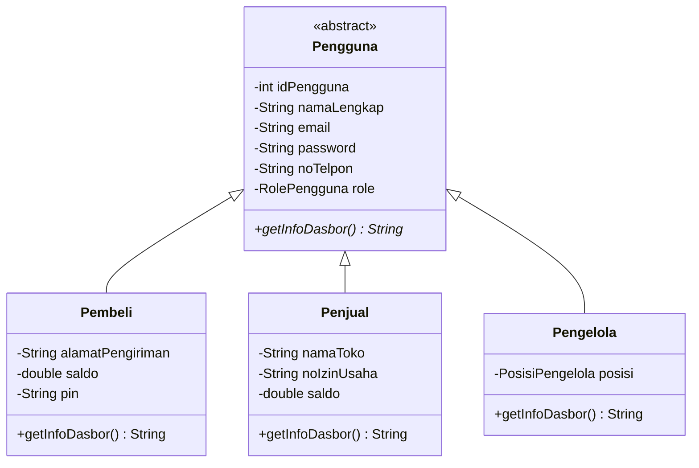

<div align="center">

# 🛍️🏪 LOKA
### Lapak Online Komunitas Lokal

*Marketplace digital untuk memberdayakan UMKM lokal di Kota Samarinda*


</div>

---

## Deskripsi Singkat ─ ★ ˙ ̟ !!

LOKA merupakan sebuah platform marketplace digital yang didedikasikan secara eksklusif untuk pemberdayaan Usaha Mikro, Kecil, dan Menengah (UMKM) lokal di wilayah Kota Samarinda. Platform ini dirancang untuk mengatasi keterbatasan jangkauan pemasaran dan mengelola operasional bisnis secara terstruktur melalui sistem digital. Dengan fitur dasbor penjual, pencarian katalog produk, integrasi pembayaran digital, hingga kalkulasi ongkos kirim berdasarkan jarak, LOKA memfasilitasi pertemuan antara penjual dan pembeli secara efisien.

Pengembangan sistem ini sejalan dengan komitmen terhadap *Sustainable Development Goals* (SDGs):

| SDG | Poin |
|:---:|------|
| 8 | Pekerjaan Layak & Pertumbuhan Ekonomi |
| 9 | Industri, Inovasi, & Infrastruktur |
| 12 | Konsumsi & Produksi yang Bertanggung Jawab |

---

## Fitur Utama Program ─ ★ ˙ ̟ !!

### 1. Autentikasi & Manajemen Hak Akses

Sistem ini mengimplementasikan keamanan berlapis dengan membagi pengguna ke dalam 3 entitas (aktor) utama yang memiliki hak akses (*privileges*) berbeda:

| Aktor | Peran | Hak Akses |
|-------|-------|-----------|
| **Pengelola** (Admin & Verifikator) | Pengawas ekosistem | Verifikator memverifikasi pendaftaran toko UMKM baru dan menyetujui/menolak izin jual produk. Admin melihat analitik laporan pendapatan (total bayar) seluruh transaksi berdasarkan periode waktu tertentu. |
| **Penjual** (UMKM) | Pemilik toko | Dasbor khusus untuk mendaftarkan nama toko & nomor izin usaha, menambahkan produk ke katalog, memperbarui stok, dan menangani pesanan masuk (status "Diproses", "Dikirim", "Selesai", "Pengembalian", "Dikembalikan"). |
| **Pembeli** | Konsumen | Akses penuh ke etalase produk, menambahkan barang ke keranjang, mengisi saldo dompet digital (Top-Up), dan melacak status barang yang dibeli. |

### 2. Sistem Transaksi Cerdas & Kalkulasi Logistik

Proses pemesanan barang (*checkout*) tidak dilakukan secara manual, melainkan diotomatisasi penuh oleh logika sistem:

- **Kalkulasi Ongkos Kirim Dinamis**
  Sistem otomatis mengalkulasi biaya kirim berdasarkan input jarak (km). Tarif yang ditetapkan adalah **Rp4.000 per kilometer** (jarak dibulatkan ke atas), dengan batas tarif ongkos kirim minimal sebesar **Rp8.000**.

- **Validasi End-to-End**
  Sebelum transaksi dicatat, sistem mengecek:
  1. Apakah stok produk mencukupi jumlah yang ingin dibeli?
  2. Apakah saldo LOKA-Pay pembeli cukup untuk membayar total belanja + ongkos kirim?

- **Sinkronisasi Otomatis**
  Apabila validasi berhasil, sistem langsung membuat data `Pesanan` dan `DetailPesanan`, lalu secara *real-time* memotong saldo pembeli dan mengurangi ketersediaan stok produk di database penjual.

### 3. Manajemen Data Interaktif Terpusat (CRUD System)

Sistem memberikan keleluasaan bagi pengguna untuk memanipulasi data operasional (*Create, Read, Update, Delete*) sesuai porsinya:

- **Manajemen Katalog (Penjual)**
  UMKM dapat mendaftarkan produk baru (Create), melihat daftar produk mereka (Read), mengubah harga/deskripsi/gambar/stok produk (Update), serta menghapus produk yang sudah tidak dijual (Delete).

- **Manajemen Keranjang (Pembeli)**
  Pembeli dapat menyimpan barang di keranjang, menelusuri isi keranjang, dan menghapus barang jika tidak jadi membeli. Setelah *checkout* dari keranjang berhasil, sistem otomatis membersihkan (Delete) produk tersebut dari keranjang pembeli.

### 4. Layanan Pasca-Pembelian (Pengembalian & Ulasan)

Untuk menjaga kepercayaan dan transparansi ekosistem jual-beli lokal:

- **Sistem Pengembalian**
  Jika barang rusak atau tidak sesuai, pembeli dapat mengajukan form retur yang berisi alasan komplain dan nominal dana yang diminta. Status pengembalian awalnya adalah "Diproses", kemudian penjual berwenang memperbarui statusnya menjadi "Pengembalian Disetuju" atau "Pengembalian Ditolak".

- **Rating & Ulasan**
  Setelah pesanan selesai, pembeli dapat memberikan umpan balik publik berupa teks komentar dan *rating* (skala divalidasi antara 1.0 hingga 5.0 bintang) untuk membangun reputasi toko UMKM terkait.

### 5. Komunikasi & Pembayaran Internal

- **Pesan Pribadi**
  Modul pertukaran pesan yang memungkinkan pembeli berkonsultasi langsung dengan penjual. Sistem mencatat waktu pengiriman dan melacak status pesan (Sudah Dibaca / Belum Dibaca).

- **Top-Up LOKA-Pay**
  Dompet digital internal tempat pembeli mengisi saldo (diinput dan divalidasi tidak boleh minus). Saldo ini menjadi satu-satunya metode pembayaran sah dan terintegrasi di dalam aplikasi LOKA.

---

## Tech Stack ─ ★ ˙ ̟ !!

| Kategori | Teknologi |
|----------|-----------|
| Bahasa Pemrograman | Java |
| Build Automation Tool | Apache Maven |
| Framework GUI | Java Swing |
| Database | MySQL |
| Library/Driver | MySQL Connector/J (JDBC) |
| Arsitektur Sistem | MVC + DAO Pattern |
| Tools Pengembangan | Apache NetBeans, Laragon, Figma, draw.io, Data Modeler |

---

## Perancangan Sistem ─ ★ ˙ ̟ !!

**ERD**


**Relational**


**Flowchart & Use Case**

<!-- TODO: tempel gambar flowchart dan use case di sini -->
*(Segera ditambahkan)*

---

## Struktur Folder/Package ─ ★ ˙ ̟ !!

```text
LOKA/
├── pom.xml
└── src/main/java/
    ├── model/      → Pengguna, Pembeli, Penjual, Pengelola, Produk, Keranjang,
    │                 Pesanan, DetailPesanan, Pengembalian, Pesan, TopUp, Ulasan
    ├── enums/      → RolePengguna, StatusAkun, StatusVerifikasi, StatusPesanan,
    │                 StatusPengembalian, PosisiPengelola, dll.
    ├── dao/        → PembeliDAO, PenjualDAO, PengelolaDAO, ProdukDAO, PesananDAO, dll.
    ├── controll/   → LokaControl (logika bisnis & checkout)
    └── view/       → Form-form Java Swing   (sesuaikan dengan nama package GUI)
```

---

## Penerapan OOP ─ ★ ˙ ̟ !!

| Pilar | Penerapan | Lokasi |
|-------|-----------|--------|
| Encapsulation | Atribut `private` + setter dengan validasi | `Pengguna`, `Pembeli`, `Penjual`, `Pengelola` |
| Inheritance | `Pembeli`, `Penjual`, `Pengelola` mewarisi `Pengguna` | package `model` |
| Abstraction | *Abstract class* `Pengguna` dan tipe data `enum` | `Pengguna`, package `enums` |
| Polymorphism | *Method overriding* `getInfoDasbor()` dan *method overloading* `ambilSemuaProduk()` | `Pengguna` dan subclass, `LokaControl` |

Hierarki class pada sistem LOKA:



### Encapsulation

Encapsulation adalah proses menyembunyikan data (atribut) melalui modifikator `private` dan hanya memperbolehkan akses melalui method khusus (getter dan setter). Pada LOKA, konsep ini diterapkan dengan menambahkan validasi di dalam setter (misalnya memastikan format email memiliki `@` atau saldo tidak boleh minus). Konstruktor juga memanggil setter, sehingga data selalu tervalidasi sejak objek dibuat dan integritas data terjaga sebelum diproses oleh sistem.

**Class `Pengguna`**: atribut `private`, setter memanggil validasi sebelum menyimpan nilai.

```java
public abstract class Pengguna {
    private String email;
    private String password;
    // ...

    public String getEmail() { return email; }

    public void setEmail(String email) {
        if (validasiEmail(email)) {
            this.email = email;
        }
    }

    public boolean validasiEmail(String email) {
        if (email != null && email.contains("@") && email.contains(".")) {
            return true;
        } else {
            System.out.println("Peringatan: Format email tidak valid (harus mengandung '@' dan '.')!");
            return false;
        }
    }
}
```

**Class `Pembeli`**: validasi saldo agar tidak bernilai minus.

```java
public class Pembeli extends Pengguna {
    private double saldo;
    // ...

    public double getSaldo() { return saldo; }

    public void setSaldo(double saldo) {
        if (validasiSaldoPembeli(saldo)) {
            this.saldo = saldo;
        }
    }

    public boolean validasiSaldoPembeli(double saldo) {
        if (saldo >= 0) {
            return true;
        } else {
            System.out.println("Peringatan: Saldo pembeli tidak boleh bernilai minus!");
            return false;
        }
    }
}
```

### Inheritance

Inheritance (Pewarisan) digunakan untuk mencegah duplikasi kode dengan mewariskan atribut dan method dasar dari *super-class* `Pengguna` (ID, nama, email, password, nomor telepon, dan role) kepada tiga *sub-class* spesifik: `Penjual`, `Pembeli`, dan `Pengelola`. Melalui pemanggilan konstruktor `super(...)` di dalam konstruktor masing-masing, *sub-class* menginisialisasi identitas dasarnya ke class induk sekaligus menambahkan atribut eksklusifnya sendiri, seperti `namaToko` untuk Penjual, `alamatPengiriman` untuk Pembeli, dan `posisi` (Admin/Verifikator) untuk Pengelola. Karena atribut induk bersifat `private`, *sub-class* mengaksesnya melalui getter, misalnya `getNamaLengkap()`.

#### Class Penjual

Class ini mewarisi atribut identitas dasar dari `Pengguna`, namun mendefinisikan atribut yang secara eksklusif dimiliki entitas bisnis, yaitu `namaToko`, `noIzinUsaha`, dan `saldo` operasional toko.

```java
public class Penjual extends Pengguna {
    private String namaToko;
    private String noIzinUsaha;
    private double saldo;
    // ...

    public Penjual(int idPengguna, String namaLengkap, String email, String password,
                   String noTelpon, RolePengguna role, String namaToko, String deskripsiToko,
                   String alamatToko, String kota, String kecamatan, String kodePos,
                   double saldo, String noIzinUsaha, StatusVerifikasi statusVerifikasi,
                   Date tanggalVerifikasi, StatusAkun statusAkun, Date tanggalDaftar) {

        super(idPengguna, namaLengkap, email, password, noTelpon, role); // atribut warisan dari Pengguna

        setNamaToko(namaToko);            // atribut khusus Penjual
        setSaldo(saldo);
        setNoIzinUsaha(noIzinUsaha);
        // ...
    }
}
```

#### Class Pembeli

Sama halnya dengan Penjual, `Pembeli` menggunakan `extends Pengguna`. Namun, alih-alih atribut bisnis, ia menambahkan atribut yang mendukung kegiatan belanja, seperti `alamatPengiriman`, saldo LOKA-Pay pribadi, dan `pin` keamanan transaksi.

```java
public class Pembeli extends Pengguna {
    private String alamatPengiriman;
    private double saldo;
    private String pin;
    // ...

    public Pembeli(int idPengguna, String namaLengkap, String email, String password,
                   String noTelpon, RolePengguna role, Date tanggalLahir,
                   JenisKelamin jenisKelamin, String kota, String kecamatan, String kodePos,
                   String alamatPengiriman, double saldo, String pin,
                   StatusAkun statusAkun, Date tanggalDaftar) {

        super(idPengguna, namaLengkap, email, password, noTelpon, role); // atribut warisan dari Pengguna

        this.alamatPengiriman = alamatPengiriman;   // atribut khusus Pembeli
        setSaldo(saldo);
        setPin(pin);
        // ...
    }
}
```

#### Class Pengelola (Admin/Verifikator)

Berbeda dengan Pembeli atau Penjual yang terlibat langsung dalam transaksi komersial, `Pengelola` didesain untuk manajemen sistem di balik layar. Setelah mewarisi kredensial dasar dari `Pengguna`, class ini menambahkan satu atribut otorisasi, yaitu `posisi` (tipe `enum PosisiPengelola`), yang membedakan wewenang Admin (pemantau analitik) dan Verifikator (pemberi validasi).

```java
public class Pengelola extends Pengguna {
    private PosisiPengelola posisi;   // atribut khusus Pengelola

    public Pengelola(int idPengguna, String namaLengkap, String email, String password,
                     String noTelpon, RolePengguna role, PosisiPengelola posisi) {

        super(idPengguna, namaLengkap, email, password, noTelpon, role); // atribut warisan dari Pengguna
        setPosisi(posisi);
    }
}
```

### Abstraction

Abstraction (Abstraksi) menyembunyikan detail implementasi dan hanya menampilkan kontrak yang esensial. Pada LOKA, abstraksi diterapkan dengan dua cara:

**1. *Abstract class* `Pengguna`.** `Pengguna` dideklarasikan `abstract` karena tidak ada pengguna yang "hanya pengguna": setiap pengguna pasti berperan sebagai Pembeli, Penjual, atau Pengelola. Class ini mendeklarasikan method abstrak `getInfoDasbor()` yang hanya menetapkan *apa* yang harus ada (informasi dasbor), sedangkan *bagaimana* isinya disusun diserahkan kepada masing-masing *sub-class*.

```java
public abstract class Pengguna {
    // ...

    // method abstrak: hanya kontrak, tanpa isi
    public abstract String getInfoDasbor();
}
```

**2. Tipe data `enum`.** Enum seperti `StatusPesanan` menyembunyikan penggunaan string mentah dan menjadi kontrak konstan yang mencegah kesalahan pengetikan (*human error*), sehingga status operasional di database selalu konsisten.

```java
package enums;

public enum StatusPesanan {
    Diproses,
    Dikirim,
    Selesai,
    Pengembalian,
    Dikembalikan
}
```

Pemakaian pada `LokaControl`, status diberikan lewat enum, bukan string mentah:

```java
buatPesanan(noPesanan, idPenjual, idPembeli, new Date(), jarak, ongkir, total,
            StatusPesanan.Diproses, null, null);
```

### Polymorphism

Polymorphism (Polimorfisme) memungkinkan satu method yang sama menghasilkan perilaku berbeda tergantung objek yang memanggilnya. Pada LOKA, polimorfisme diterapkan melalui **method overriding**: method abstrak `getInfoDasbor()` dari *super-class* `Pengguna` diimplementasikan ulang (`@Override`) oleh `Pembeli`, `Penjual`, dan `Pengelola` sesuai kebutuhan masing-masing aktor.

**Sub-class `Pembeli`**: menampilkan saldo LOKA-Pay.

```java
@Override
public String getInfoDasbor() {
    return "Selamat berbelanja, " + getNamaLengkap()
            + " | Saldo LOKA-Pay: Rp" + String.format("%,.0f", saldo);
}
```

**Sub-class `Penjual`**: menampilkan nama toko dan saldo toko.

```java
@Override
public String getInfoDasbor() {
    return "Toko " + namaToko + " | Saldo toko: Rp" + String.format("%,.0f", saldo);
}
```

**Sub-class `Pengelola`**: menampilkan posisi (Admin/Verifikator).

```java
@Override
public String getInfoDasbor() {
    return "Panel " + posisi + " | " + getNamaLengkap();
}
```

**Pemanfaatan polimorfisme**: method `login()` pada `LokaControl` mengembalikan tipe `Pengguna` (*super-class*), padahal objek aslinya bisa `Pembeli`, `Penjual`, atau `Pengelola`. Hasilnya ditampung dalam variabel bertipe `Pengguna`, lalu satu baris pemanggilan `getInfoDasbor()` otomatis menjalankan versi milik objek aslinya, tanpa pengecekan `instanceof`.

```java
Pengguna user = lokaControl.login(email, password);   // tipe referensi: Pengguna
if (user != null) {
    System.out.println(user.getInfoDasbor());         // versi yang jalan mengikuti objek aslinya
}
```

Selain *overriding*, LOKA juga memakai **method overloading** pada `LokaControl`: `ambilSemuaProduk()` mengambil seluruh produk, sedangkan `ambilSemuaProduk(int idPenjual)` hanya mengambil produk milik satu penjual.

```java
public List<Produk> ambilSemuaProduk() {
    return produkDAO.getAllProduk();
}

public List<Produk> ambilSemuaProduk(int idPenjual) {
    List<Produk> hasil = new ArrayList<>();
    for (Produk p : produkDAO.getAllProduk()) {
        if (p.getPenjualIdPengguna() == idPenjual) {
            hasil.add(p);
        }
    }
    return hasil;
}
```

---

## Cara Penggunaan Program ─ ★ ˙ ̟ !!

<!-- TODO: sesuaikan langkah-langkah di bawah dengan project kalian -->

1. **Clone repository**
   ```bash
   git clone <url-repository>
   ```
2. **Siapkan database MySQL**: aktifkan **Laragon** (*Start All*), buat database, lalu impor file `.sql` milik project.
3. **Atur koneksi database**: sesuaikan *host*, *username*, dan *password* pada class koneksi.
4. **Jalankan aplikasi**: buka project di NetBeans, lakukan *Clean and Build*, lalu *Run* (atau gunakan `mvn clean install`).
5. **Login** menggunakan akun Pembeli, Penjual, atau Pengelola sesuai peran yang ingin dicoba.

---

## Kontributor ─ ★ ˙ ̟ !!

| No | Nama | NIM | Kelas |
|:--:|------|:---:|:-----:|
| 1 | Nazmi Ramadani | 2509116031 | A |
| 2 | Atha Rina Sarwahita | 2509116047 | B |
| 3 | Naisyla Auliya Rahmi Putri | 2509116078 | B |
| 4 | Qonitah Khansa' Ayu Madani A | 2509116113 | C |

---

<div align="center">

Terima kasih sudah mampir di LOKA! 🛍️🏪

</div>
